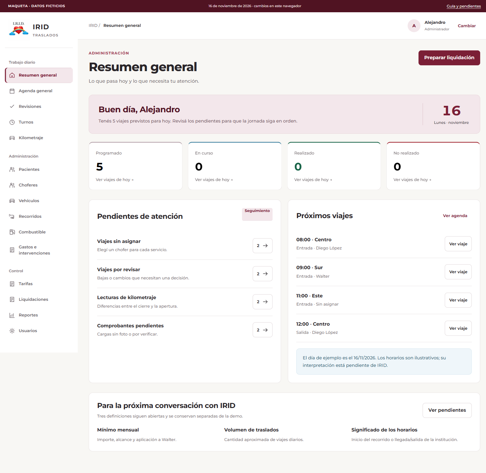

# IRID · Maqueta interactiva

Prototipo para validar con IRID los flujos de traslados, flota y administración. Incluye accesos rápidos de Alejandro, Walter, Secretaria y Chofer, datos ficticios, acciones simuladas, historial, liquidaciones versionadas y descargas Excel/PDF.

## Abrir la demo

**[Abrir IRID en GitHub Pages](https://alejopalavecino.github.io/Demo-Irid-v1.0/)**. Podés compartir este enlace para probar los cuatro perfiles desde el celular o la computadora, sin instalar nada. Los datos de prueba se conservan por navegador; no se comparten entre dispositivos.

Abrí [`index.html`](index.html) en un navegador actual. No requiere instalación ni conexión. El logo y Montserrat están incrustados. Para compartirla, descargá el paquete de [`releases/`](releases/).

Los cambios se guardan en el navegador usado. «Cambiar de perfil» los conserva y «Reiniciar datos» restaura los ejemplos. El día simulado es el 16/11/2026. Las cuentas iniciales `alejandro`, `walter`, `secretaria` y `diego` usan `demo123`; son credenciales ficticias y no representan seguridad productiva.

Consultá la [guía de presentación](docs/guia-demo.md). Podés usar el [comprobante ficticio](tests/fixtures/comprobante-ficticio.png) para probar los adjuntos.

## Versión 1.1 · Diseño adaptable

La identidad conserva el bordó, los fondos claros, Montserrat y el logo original. Esta iteración mejora la jerarquía, los espacios, la lectura de horarios y los estados; usa un menú lateral en escritorio y desplegable en tablet y celular.

Los listados administrativos se convierten en fichas en pantallas pequeñas. Las tablas financieras tienen desplazamiento propio y aviso visible. Los formularios se apilan en móvil; con poca altura se puede desplazar todo el diálogo. El menú y los cambios de tamaño conservan los campos ingresados.

[Descargar paquete portable v1.1](releases/IRID-demo-v1.1.zip) · [Verificación y límites](docs/verification/responsive-v1-1/verification.md)



## Desarrollo

Node.js 22 o posterior, sin paquetes externos ni instalación de dependencias:

```sh
npm test
npm run build
```

Editá `src/`. El build genera `index.html` y una copia en `dist/IRID-maqueta-interactiva.html`; ambos son autónomos. `index.html` se versiona para que se pueda abrir después de clonar o descargar el repositorio.

GitHub Pages publica la raíz de `main`. El archivo `.nojekyll` permite servir el HTML estático sin procesarlo con Jekyll. Para actualizar la versión web, ejecutá el build y publicá el `index.html` resultante en `main`.

## Contenido

| Ruta | Contenido |
| --- | --- |
| `src/` | Motor de reglas, pantallas, estilos y plantilla. |
| `assets/` | Logo original, Montserrat y su licencia. |
| `tests/` | Reglas, permisos simulados, reportes y exportaciones. |
| `docs/specifications/` | Especificación funcional y decisiones UX confirmadas. |
| `docs/verification/` | Evidencia de pruebas y límites de cada versión. |
| `docs/design/` | Referencias y evolución visual. |
| `odd/tasks/` | Registro del trabajo y sus verificaciones. |
| `releases/` | Paquetes descargables de la maqueta. |

## Límites y pendientes

Es una demo estática disponible en GitHub Pages y como archivo local: no tiene backend, autenticación segura, almacenamiento privado ni respaldos. No ingreses información sensible ni claves reales. La validación con el cliente está pendiente.

- Q-001: importe y aplicación del mínimo mensual garantizado.
- Q-002: volumen aproximado de traslados diarios.
- Q-003: significado de los horarios de Entrada/Salida.

Estas preguntas siguen abiertas y visibles en la guía de la demo. El prototipo no sustituye sus respuestas ni el plan de implementación productiva.

Montserrat se distribuye con [SIL Open Font License](assets/fonts/OFL.txt). El logo de IRID fue aportado para esta maqueta; no se concede una licencia general sobre la identidad de la institución.
